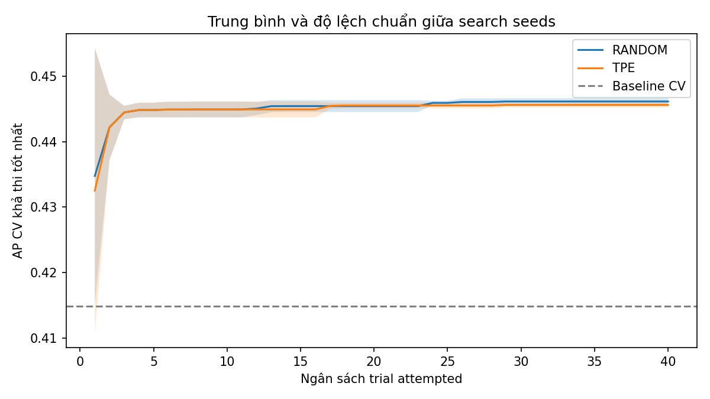
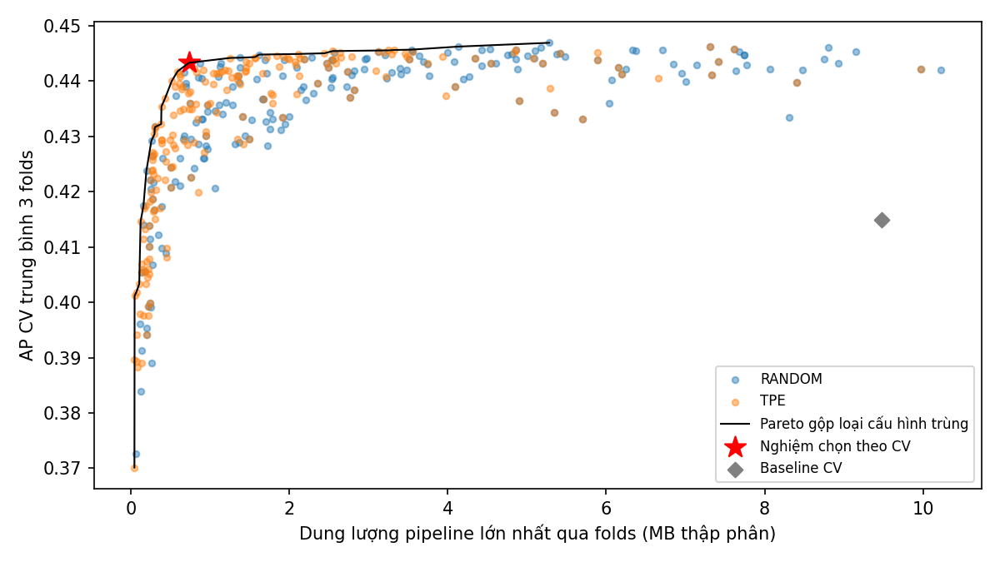

# Tối ưu bốn siêu tham số Random Forest

Đồ án Nhập môn Tối ưu hóa trên UCI Bank Marketing. Repository đích: https://github.com/NTP010205/NMTUH_VLU.

Protocol `ap_model_size_4hp_v2` tìm `n_estimators`, `max_depth`, `min_samples_leaf`, `max_features`; cố định `class_weight=None`, model/split/CV seed 42 và một thread. Random Search và TPE thay riêng sampler seed trong `[42,52,62,72,82]`, mỗi study có 40 trial attempted. Tổng 400 trials, 1.200 fold fits nếu tất cả hoàn thành. Đây là bốn siêu tham số RF, không phải SGD, Momentum, RMSProp, Adam; RF không dùng learning_rate hay batch_size trong thí nghiệm này.

## Bài toán và chọn nghiệm

`x = (n_estimators, max_depth, min_samples_leaf, max_features)`.

| Biến | Miền |
|---|---|
| n_estimators | Số nguyên 50–300, bước 25 |
| max_depth | Số nguyên 4–24 |
| min_samples_leaf | Số nguyên 1–12 |
| max_features | Số thực 0,4–1,0; tỷ lệ cột sau tiền xử lý |

Tối đa hóa `AP_CV = mean(AP_1,AP_2,AP_3)` và tối thiểu hóa `S = max(size_bytes_1,size_bytes_2,size_bytes_3)/1e6`, ràng buộc `S ≤ 50 MB`. Serialize toàn bộ fitted preprocessing + RF bằng Joblib compress=3. AP tính bằng `average_precision_score` từ `predict_proba`, không phải accuracy hoặc diện tích PR hình thang. Latency không tham gia mục tiêu hoặc Pareto.

Giữ COMPLETE+feasible với AP cách best không quá 0,005; chọn CV size nhỏ nhất, hòa thì AP cao hơn, fold std nhỏ hơn, config hash, sampler, trial. Nghiệm cuối lấy từ tập gộp 400 trials, không đại diện trung bình một sampler. Refit trên toàn train, kiểm tra size ≤ 50 MB; nếu fail thử tiếp trong cùng near-best. Không đổi tolerance hoặc cap sau khi xem kết quả.

## Kết quả v2

<!-- FINAL_RESULTS_START -->
Đã hoàn thành ngân sách 400 attempted trials: 398 COMPLETE, 2 FAIL. Các lỗi vẫn được tính vào budget và giữ trong logs.

| Sampler | Best AP mean ± std giữa 5 runs | AP chọn mean ± std |
|---|---:|---:|
| random | 0.446143 ± 0.000503 | 0.442222 ± 0.001157 |
| tpe | 0.445613 ± 0.000367 | 0.441515 ± 0.000622 |

Baseline CV AP: 0.414861 ± 0.007495 (std giữa folds). Nghiệm cuối từ ngân sách gộp: `n_estimators=50`, `max_depth=14`, `min_samples_leaf=11`, `max_features=0.6468411998858646`.

Selected CV AP 0.443294, max-fold size 0.735 MB; full-train size 0.919 MB.

Nguồn: [run_summary.csv](results/analysis/final/run_summary.csv), [sampler_summary.csv](results/analysis/final/sampler_summary.csv), [selected_candidate.json](results/final/selected_candidate.json).





Báo cáo nội dung: [Bao_cao_NMTUH.md](report/Bao_cao_NMTUH.md). Tóm tắt bảo vệ: [Tom_tat_bao_ve.md](report/Tom_tat_bao_ve.md). File Word chỉ được nghiệm thu sau khi render và kiểm tra từng trang.
<!-- FINAL_RESULTS_END -->

## Phương pháp và giới hạn

Random Search lấy mẫu cấu hình trong miền đã khóa. Optuna TPE dùng lịch sử đánh giá để điều chỉnh các đề xuất; 10 trial khởi tạo lấy mẫu ngẫu nhiên. Hai sampler dùng cùng dữ liệu, folds và ngân sách attempted. Baseline là RF mặc định; việc tìm kiếm không cố ý làm baseline yếu đi.

Năm search seeds chỉ mô tả biến động tìm kiếm trên cùng dữ liệu và folds. CV được dùng để chọn nghiệm nên có thiên lệch lựa chọn; chưa có đánh giá độc lập trên dữ liệu mới. Holdout từng được baseline v1 đánh giá và không dùng để tuning v2. Dung lượng Joblib không đại diện cho RAM hoặc latency. Không kết luận tối ưu toàn cục hay TPE luôn thắng; lỗi vận hành vẫn tính vào ngân sách và được công bố.

## Cấu trúc repository

| Đường dẫn | Nội dung |
|---|---|
| `configs/final.yaml` | Protocol v2, miền bốn biến, seeds và ngân sách |
| `src/`, `tests/` | Runner, phân tích, chọn nghiệm và kiểm thử hành vi |
| `results/final/` | Baseline và logs chính thức v2 theo seed/sampler |
| `results/analysis/final/`, `figures/final/` | Bảng và hình dựng từ logs v2 |
| `results/sensitivity/` | Đánh giá lân cận sau khi khóa nghiệm |
| `report/` | Báo cáo cuối, tóm tắt bảo vệ và báo cáo rà soát lịch sử |
| `notebooks/`, `docs/archive/` | Notebooks v1 và chỉ mục lịch sử; không đổi nhãn thành v2 |
| `data/README.md` | Nguồn dữ liệu, cách tải và checksum |

## Cài đặt và dữ liệu

Python 3.11, chạy từ gốc dự án:

```powershell
py -3.11 -m venv .venv
.venv/Scripts/python.exe -m pip install -r requirements.txt
.venv/Scripts/python.exe scripts/download_data.py
```

[Hướng dẫn dữ liệu và checksum](data/README.md). Dùng `bank-full.csv`, 45.211 dòng, 17 cột; bỏ `duration`, còn 15 đặc trưng gốc. Frozen split gồm 36.168 train, 9.043 holdout; ba CV folds chỉ trên train. Tiền xử lý fit riêng từng training fold; giữ `unknown`. Holdout từng được đánh giá ở baseline v1, không phải tập chưa từng xem. Search và sensitivity v2 không đọc holdout.

## Kiểm thử và chạy lại từ clone

Clone chứa logs chính thức nhưng không chứa DB/checkpoint. Phân tích kết quả đã bàn giao bằng `python -m src.analyze_results` như mục kế tiếp. Để chạy thí nghiệm mới, dùng namespace `reproduction`:

```powershell
.venv/Scripts/python.exe -m pytest -q
.venv/Scripts/python.exe -m compileall -q src tests scripts
.venv/Scripts/python.exe -m src.run_experiments --mode smoke --output results/reproduction_smoke
.venv/Scripts/python.exe -m src.run_experiments --mode full --output results/reproduction
.venv/Scripts/python.exe -m src.analyze_results --input results/reproduction --output results/analysis/reproduction --figures figures/reproduction
.venv/Scripts/python.exe -m src.finalize_experiments --input results/reproduction
```

Smoke dùng 2 trials/sampler ở seed 42, lưu riêng với full. Trong workspace chính thức, output mặc định là `results/smoke_v2` và `results/final`; các lệnh trên tạo bản chạy lại riêng. Chỉ chạy full khi tests và smoke PASS. Full chạy tuần tự; baseline CV cùng môi trường. Baseline RF mặc định (100 cây, depth=None, leaf=1, max_features='sqrt') có thể nằm ngoài search domain.

`finalize_experiments` khóa lựa chọn, refit selected và baseline, chạy sensitivity cục bộ sau khóa, sinh lại bảng/hình. Mỗi biến tối đa ba giá trị gồm selected và hai lân cận, giữ ba biến còn lại; không sửa nghiệm chính theo sensitivity. Thiếu full thì finalization từ chối chạy.

Với input `results/reproduction`, bước finalize ghi sensitivity vào `results/sensitivity_reproduction`, bảng vào `results/analysis/reproduction` và hình vào `figures/reproduction`. Nó không ghi đè bản chính thức. Có thể chỉ định `--analysis-output`, `--sensitivity`, `--figures` nếu cần namespace khác.

## Phân tích từ clone không có DB

```powershell
.venv/Scripts/python.exe -m src.analyze_results
```

Phân tích chỉ đọc logs Git track, kiểm tra manifests, CSV với JSON và tính lại aggregates từ fold. Không cần raw data, model hoặc SQLite. Có DB thì kiểm tra states/objectives bổ sung; thiếu thì ghi `not checked (database absent)`. Bảng/hình ở `results/analysis/final/` và `figures/final/`. Std giữa 5 search runs khác std giữa 3 CV folds; baseline chỉ có một kết quả CV.

## Resume và chạy lại độc lập

Workspace đã chạy dùng lại lệnh full để resume; đủ budget không thêm trial. Trial lỗi tính vào budget và ghi lý do; trial bị ngắt được đánh FAIL khi resume. Không chạy hai runner cùng output. Resume cần DB và sampler checkpoint cục bộ; `.pkl` bị Git-ignore và không được lấy từ nguồn không tin cậy.

Từ clone có log nhưng thiếu DB, chạy vào output mới:

```powershell
.venv/Scripts/python.exe -m src.run_experiments --mode smoke --output results/reproduction_smoke
.venv/Scripts/python.exe -m src.run_experiments --mode full --output results/reproduction
.venv/Scripts/python.exe -m src.analyze_results --input results/reproduction --output results/analysis/reproduction --figures figures/reproduction
```

Runner từ chối resume nếu config, data, split, folds, implementation hoặc environment fingerprint khác. Không xóa kết quả để vượt kiểm tra. `--seed 52` chọn một seed đã đăng ký, không giảm budget. `--allow-partial` chỉ phân tích tạm và luôn ghi PARTIAL.

## Tài liệu và lịch sử

[Chỉ mục v1](docs/archive/README.md), [prompt yêu cầu](PROMPT_CODEX_HOAN_THIEN.md), [log kiểm thử](docs/review/pytest_v2.log). Kết quả v1 và báo cáo rà soát giữ nhãn lịch sử. Audit v1 cần DB từ gói gốc; không chạy được từ clone-only.

Codex hỗ trợ triển khai và kiểm chứng. Không giả kết quả hoặc commit lùi ngày. Năm seeds cung cấp bằng chứng mô tả hạn chế, không chứng minh TPE luôn thắng hoặc nghiệm tối ưu toàn cục.

## Sinh báo cáo và kiểm tra trang

Sau khi full, refit và sensitivity hoàn tất, `scripts/build_final_report.py` sinh nội dung tiếng Việt, bản tóm tắt bảo vệ và bảng README từ các nguồn đã kiểm tra hash. Script từ chối nguồn thiếu hoặc sai protocol.

Dùng môi trường tài liệu riêng để không đổi fingerprint môi trường huấn luyện:

```powershell
py -3.11 -m venv ../.document_env
../.document_env/Scripts/python.exe -m pip install -r requirements-report.txt
../.document_env/Scripts/python.exe scripts/build_final_report.py --docx
pwsh -NoProfile -File scripts/render_word.ps1
../.document_env/Scripts/python.exe scripts/render_pdf_pages.py report/qa/final/Bao_cao_NMTUH.pdf
```

`render_word.ps1` dùng Microsoft Word đã cài trên Windows, mở DOCX read-only trong instance ẩn, xuất PDF rồi đóng instance đó. Phải xem từng ảnh `report/qa/final/page-N.png` và sửa lỗi dàn trang trước khi nghiệm thu. PDF/PNG là sản phẩm QA, bị Git-ignore. Có thể theo dõi thí nghiệm bằng `.venv/Scripts/python.exe scripts/show_progress.py`; không khởi động runner thứ hai vào cùng output.
