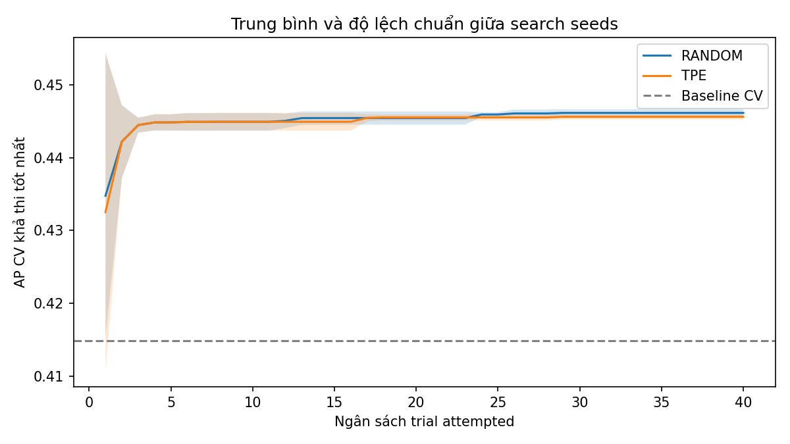
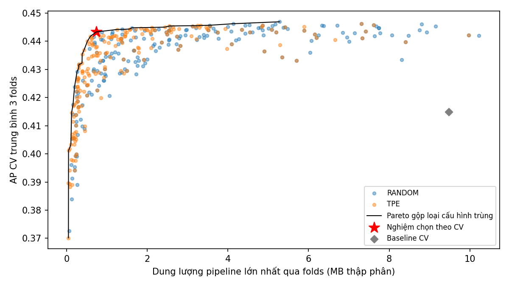
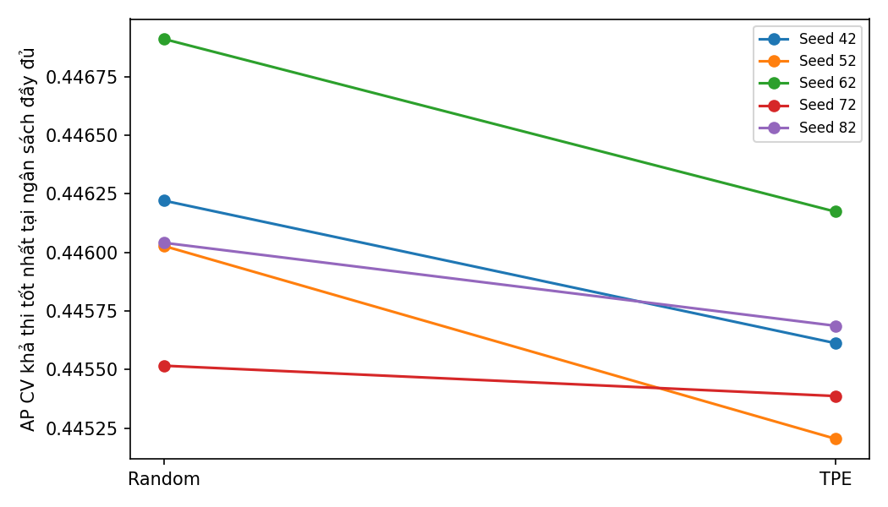
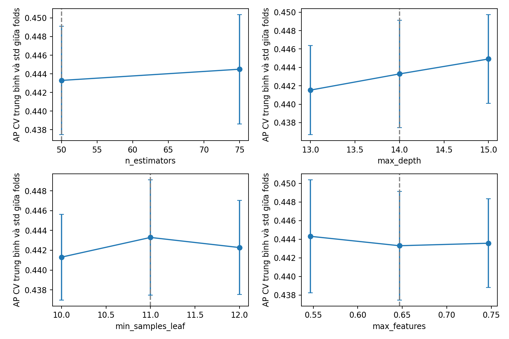

# Tối ưu bốn siêu tham số Random Forest cho Bank Marketing

Đồ án học phần Nhập môn Tối ưu hóa

Sinh viên Nguyễn Thành Phát · MSSV 2474802016639 · Lớp 261_71ITAI51403_0102

Giảng viên Nguyễn Thị Diễm Anh

Repository: https://github.com/NTP010205/NMTUH_VLU

## 1 Đặt vấn đề

Bài toán dự đoán một khách hàng có đăng ký tiền gửi có kỳ hạn hay không là bài toán học có giám sát, với nhãn y nhận giá trị yes hoặc no. Mục đích nghiên cứu là tìm một cấu hình Random Forest có chất lượng xếp hạng tốt, đồng thời giảm dung lượng lưu trữ của toàn bộ quy trình dự đoán.

Hai tiêu chí có thể xung đột: tăng số cây hoặc độ sâu có thể nâng chất lượng nhưng tạo tệp mô hình lớn hơn. Vì vậy, đồ án đánh giá nhiều cấu hình theo hai mục tiêu, xác định tập Pareto và áp dụng một quy tắc lựa chọn đã khóa trước thực nghiệm. Dung lượng được đo trực tiếp sau khi huấn luyện, không suy đoán từ số cây.

Thực nghiệm sử dụng 5 search seeds, hai sampler và 400 trials attempted. Nghiệm cuối có CV AP 0.443294, so với baseline 0.414861; chênh lệch tuyệt đối là +0.028434. Dung lượng max-fold của nghiệm chọn là 0.735 MB. Đây là so sánh trên các folds đã dùng cho lựa chọn, cần đọc cùng những giới hạn ở phần thảo luận.

Phạm vi giữ một họ mô hình RandomForestClassifier. Bốn biến quyết định là bốn siêu tham số cụ thể của mô hình; chúng không phải bốn bộ tối ưu SGD, Momentum, RMSProp và Adam. Thí nghiệm không đưa learning_rate, batch_size, deep learning hay latency vào bài toán.

# 2 Mô hình hóa

Vector quyết định x = (n_estimators, max_depth, min_samples_leaf, max_features) thuộc miền hỗn hợp số nguyên và số thực. Việc đánh giá một điểm x cần huấn luyện pipeline trên ba training folds và dự đoán xác suất trên các validation folds tương ứng.

Bảng 1 Miền tìm kiếm được khóa trong configs/final.yaml

| Biến | Miền | Ý nghĩa |
| --- | --- | --- |
| n_estimators | 50 đến 300, bước 25 | Số cây trong rừng |
| max_depth | Số nguyên 4 đến 24 | Độ sâu tối đa của cây |
| min_samples_leaf | Số nguyên 1 đến 12 | Số mẫu tối thiểu tại lá |
| max_features | Số thực 0,4 đến 1,0 | Tỷ lệ cột sau tiền xử lý xét tại phép tách |

AP_CV(x) = [AP₁(x) + AP₂(x) + AP₃(x)] / 3

S(x) = maxₖ size_bytes(Pipelineₖ(x)) / 1 000 000; k = 1, 2, 3

min F(x) = (−AP_CV(x), S(x)); g(x) = S(x) − 50 ≤ 0

Average Precision được tính bằng average_precision_score từ xác suất predict_proba trên validation. AP tổng hợp precision theo các mức tăng recall; đây không phải accuracy và không đồng nhất với diện tích PR tính theo quy tắc hình thang [2].

S là dung lượng tệp Joblib của toàn bộ fitted preprocessing và RF với compress=3, dùng MB thập phân. Đây không phải dung lượng RAM, kích thước riêng các cây hay thời gian suy luận. Mục tiêu dùng max của ba folds để biểu diễn fold có tệp lớn nhất.

Cố định class_weight=None là quyết định thu gọn phạm vi, không chứng minh class_weight không ảnh hưởng. Model random_state, split seed và CV seed đều bằng 42; n_jobs=1. Chỉ seed của sampler thay đổi giữa các search runs.

# 3 Phương pháp

Random Search lấy mẫu từ miền đã định nghĩa mà không sử dụng giá trị mục tiêu của các trial trước để định hướng đề xuất. TPE dùng lịch sử đánh giá để điều chỉnh phân phối đề xuất. Với Optuna 4.9.0, TPESampler được chỉ định tường minh cho bài toán hai mục tiêu và có n_startup_trials=10 [3]. Các thiết lập này không thay đổi sau khi xem kết quả.

TPE ước lượng hai mật độ: một từ các giá trị tham số của nhóm kết quả tốt và một từ phần còn lại, rồi ưu tiên đề xuất có tỷ số mật độ thuận lợi. Trong phiên bản đa mục tiêu, trọng số của nhóm tốt dựa trên đóng góp hypervolume [3]. Đầu vào là miền biến và lịch sử mục tiêu; đầu ra là cấu hình tiếp theo, được đánh giá bằng cùng CV. TPE không cần gradient của RF.

Mỗi seed s tạo một RandomSampler(seed=s) và một TPESampler(seed=s, n_startup_trials=10, constraints_func=...). Ràng buộc trả về g=S−50; giá trị không dương là khả thi. Cả hai phương pháp dùng chung data split, CV folds, mô hình, miền và ngân sách attempted trials. Trials lỗi được ghi lý do và không được tự động chạy bù vô hạn.

Một cấu hình bị trội nếu tồn tại cấu hình khả thi khác có AP không thấp hơn, size không lớn hơn và ít nhất một mục tiêu tốt hơn nghiêm ngặt. Tập Pareto được tính từ COMPLETE+feasible, loại cấu hình trùng khi đếm. Các cấu hình bằng nhau giữa hai sampler không được coi là hai khám phá độc lập.

Quy tắc khóa trước chạy: xác định AP_best trong tập khả thi, giữ AP ≥ AP_best−0,005, rồi chọn size CV nhỏ nhất. Thứ tự hòa tiếp theo là AP cao hơn, fold std nhỏ hơn, config_hash, sampler, trial. Các tham số này không được điều chỉnh theo holdout.

Mỗi search run có một nghiệm chọn riêng để so sánh giữa runs. Mô hình cuối được chọn từ tập gộp cả năm seeds và hai sampler, tức dùng ngân sách gộp. Sau đó pipeline được refit trên toàn bộ train; nếu size vượt 50 MB thì thử ứng viên kế tiếp trong cùng tập near-best, không mở rộng tolerance.

Bản v1 là thí nghiệm lịch sử năm biến với một sampler seed; runner và logs cũ được giữ ở đường dẫn riêng. Không lấy các con số v1 rồi đổi nhãn thành kết quả bốn biến hoặc nhiều seed.

# 4 Dữ liệu và thiết kế thực nghiệm

Dữ liệu UCI Bank Marketing được tải từ bản công bố của Moro, Rita và Cortez, giấy phép CC BY 4.0 [1]. File sử dụng là bank-full.csv, có 45.211 hàng và 17 cột bao gồm nhãn y. Không thay thế bằng bank-additional-full.csv. Checksum được so với bản audit đã khóa trước khi đọc các hàng train.

Bảng 2 Thiết kế thực nghiệm v2

| Thành phần | Thiết lập |
| --- | --- |
| Đặc trưng | Bỏ duration, còn 15 đặc trưng gốc trước one-hot |
| Train và holdout | 36.168 train và 9.043 holdout, stratified 80/20 |
| CV | 3 folds trên train; mỗi fold fit 24.112 và validation 12.056 |
| Nhãn train | 4231 yes trên 36168 hàng |
| Search seeds | 42, 52, 62, 72, 82 |
| Ngân sách | 40 trials attempted mỗi sampler và seed |

duration chỉ được biết sau cuộc gọi nên bị loại khỏi đầu vào. Các cột campaign, contact, day và month vẫn được giữ theo protocol; tính sẵn có của chúng tại thời điểm triển khai cần được xác nhận riêng. Imputer và OneHotEncoder nằm trong pipeline và chỉ fit trên training fold. Validation dùng handle_unknown=ignore.

Giữ chuỗi unknown như một giá trị phân loại. Số lượng trên phần train: job=234; education=1482; contact=10386; poutcome=29589. Không chuyển ngầm các giá trị này thành null.

Baseline là RF mặc định: n_estimators=100, max_depth=None, min_samples_leaf=1, max_features=sqrt, class_weight=None, random_state=42, n_jobs=1. Baseline có thể nằm ngoài miền tìm kiếm. Chỉ có một kết quả baseline CV; không sao chép năm lần để ước lượng variance giữa runs.

Môi trường huấn luyện dùng Python 3.11.15, scikit-learn 1.5.2, Optuna 4.9.0 và các pins trong requirements.txt. Máy ghi nhận Intel Core i7-14650HX, 16 cores/24 logical processors; thực nghiệm giới hạn một thread. Thời gian dưới đây là số đo trong các phiên chạy, không phải bốn ngày lịch giữa lần bắt đầu và resume.

# 5 Kết quả thực nghiệm

Đã thử 400 trials: 398 COMPLETE và 2 FAIL. Các trial COMPLETE tương ứng 1194 fold fits đủ bộ; tổng số fold fits có log hoàn tất là 1197. Partial folds của trial lỗi được giữ trong folds.csv và không đưa vào tính Pareto. Lỗi được ghi trong trials.json, gồm gián đoạn tiến trình khi resume; vẫn tính vào ngân sách attempted.

Bảng 3 Một dòng mỗi search run từ results/analysis/final/run_summary.csv

| Seed | Sampler | Best AP | AP chọn | Size chọn MB | OK / lỗi | Pareto |
| --- | --- | --- | --- | --- | --- | --- |
| 42 | random | 0.446221 | 0.443180 | 1.141 | 39 / 1 | 10 |
| 42 | tpe | 0.445613 | 0.440791 | 0.623 | 40 / 0 | 11 |
| 52 | random | 0.446027 | 0.441512 | 0.671 | 40 / 0 | 7 |
| 52 | tpe | 0.445204 | 0.442437 | 1.449 | 40 / 0 | 16 |
| 62 | random | 0.446911 | 0.443294 | 0.735 | 40 / 0 | 9 |
| 62 | tpe | 0.446174 | 0.441206 | 0.620 | 40 / 0 | 13 |
| 72 | random | 0.445516 | 0.440584 | 0.858 | 40 / 0 | 11 |
| 72 | tpe | 0.445387 | 0.441380 | 1.038 | 39 / 1 | 17 |
| 82 | random | 0.446041 | 0.442537 | 1.127 | 40 / 0 | 13 |
| 82 | tpe | 0.445687 | 0.441762 | 0.592 | 40 / 0 | 13 |

Baseline CV AP = 0.414861 ± 0.007495; size max-fold = 9.474 MB. Độ lệch chuẩn ở câu này là sample std giữa ba folds (ddof=1), không phải độ biến động của một thuật toán tìm kiếm qua năm seeds.

Nghiệm cuối có chênh lệch AP so baseline là +0.028434, và thay đổi dung lượng CV là giảm 92.24%. So sánh này dùng cùng folds và cùng kiểu đo CV. Kết quả đã qua chọn lọc trên CV nên không phải ước lượng độc lập về mức cải thiện ngoài mẫu.

Nguồn kiểm chứng gồm CSV/JSON theo từng study, manifest hash và folds.csv. AP mean/std và max-fold bytes được tính lại từ ba hàng fold; kết quả tổng hợp không nhập tay.

# 5 Kết quả theo ngân sách tìm kiếm



Bảng 4 Best-so-far tại 10, 20 và 40 attempted trials, tính từ budget_summary.csv

| Sampler | Budget | AP mean | AP std giữa runs |
| --- | --- | --- | --- |
| random | 10 | 0.444926 | 0.001212 |
| random | 20 | 0.445437 | 0.000907 |
| random | 40 | 0.446143 | 0.000503 |
| tpe | 10 | 0.444926 | 0.001212 |
| tpe | 20 | 0.445524 | 0.000417 |
| tpe | 40 | 0.445613 | 0.000367 |

Mỗi đường theo seed lấy AP khả thi cao nhất đã quan sát đến ngân sách tương ứng. Trial lỗi vẫn chiếm một đơn vị ngân sách; đường best-so-far không tăng từ trial đó. Khi một run chưa có nghiệm khả thi, giá trị để trống và không tham gia mean/std tại mốc ấy; bảng 10/20/40 dùng đủ các runs có kết quả. Việc dùng cùng ngân sách giúp đọc trực tiếp hiệu quả tìm kiếm trong phạm vi thực nghiệm.

Số cấu hình startup giống nhau theo từng seed: seed 42: 10/10; seed 52: 10/10; seed 62: 10/10; seed 72: 10/10; seed 82: 10/10. Khi startup trùng nhau, hai phương pháp dùng cùng các điểm khởi đầu; không diễn giải chúng là các khám phá độc lập.

Bảng startup đối chiếu 10 attempted trials đầu. Optuna không dùng FAIL làm đánh giá mục tiêu; một lỗi trong giai đoạn này có thể kéo dài số attempted trials lấy mẫu ngẫu nhiên trước khi TPE đủ dữ liệu khởi tạo. Ngân sách tổng vẫn giữ 40 attempted trials mỗi study.

# 5 Pareto và nghiệm cuối



Bảng 5 Bốn giá trị của nghiệm cuối

| Siêu tham số | Giá trị được chọn |
| --- | --- |
| n_estimators | 50 |
| max_depth | 14 |
| min_samples_leaf | 11 |
| max_features | 0.6468411998858646 |

Nguồn nghiệm theo tie-break: sampler random, search seed 62, trial 0 (đánh số từ 0). Config hash: c1a236ce7be07b24f9cecad2645f2a07bf208d0d97de41d8c188e9497e343909. CV AP=0.443294 ± 0.005828; S=0.735479 MB. Các logs trùng cấu hình: random/seed 62/trial 0; tpe/seed 62/trial 0.

AP tốt nhất trong tập gộp là 0.446911; nghiệm chọn mất 0.003617 điểm AP tuyệt đối, trong tolerance 0,005. Tập Pareto có 30 cấu hình phân biệt. Lý do chọn là dung lượng nhỏ nhất trong vùng chất lượng near-best, không phải AP cao nhất hoặc một nghiệm tối ưu toàn cục.

Refit full train của nghiệm chọn đạt 0.919 MB, baseline full train 14.009 MB, giảm 93.44%. Đây là so sánh full-train với full-train. Mức lớn nhất trong các trial CV khả thi là 10.225 MB; ngưỡng 50 MB không binding trong các trial hoàn thành.

# 5 Độ ổn định giữa các seeds



Bảng 6 Mean và sample std giữa năm search runs, không phải giữa folds

| Sampler | Best AP mean ± std | AP chọn mean ± std | Size chọn mean ± std (MB) |
| --- | --- | --- | --- |
| random | 0.446143 ± 0.000503 | 0.442222 ± 0.001157 | 0.906 ± 0.218 |
| tpe | 0.445613 ± 0.000367 | 0.441515 ± 0.000622 | 0.864 ± 0.375 |

Chênh lệch best AP theo seed (TPE−Random): 42: −0.000608; 52: −0.000823; 62: −0.000737; 72: −0.000129; 82: −0.000354.

Trung bình chênh lệch ghép cặp là -0.000531, sample std 0.000286. Chỉ năm seeds tạo bằng chứng mô tả hạn chế; không suy ra một sampler luôn tốt hơn trên mọi dữ liệu hoặc ngân sách.

Các runs chia sẻ dữ liệu, folds và model seed. Vì vậy std giữa runs đo biến động của quá trình search trên cùng bài toán cố định, không đo toàn bộ bất định do lấy mẫu dữ liệu, chia folds hoặc triển khai thực tế. Các cấu hình giống nhau giữa sampler càng làm giảm cơ sở để coi mọi điểm là quan sát độc lập.

Có 2 trials bị lỗi hoặc gián đoạn vận hành. Mặc dù ngân sách attempted bằng nhau, số đánh giá COMPLETE có thể khác giữa các runs. Chênh lệch ghép cặp vì thế cũng chịu ảnh hưởng của gián đoạn, không chỉ của cách đề xuất cấu hình; cần đọc cùng bảng complete/failed.

# 5 Phân tích độ nhạy cục bộ



Sensitivity được thực hiện sau khi khóa selected_candidate.json. Mỗi lần chỉ thay một biến, giữ ba biến còn lại, cùng train và folds. Mỗi biến có tối đa ba giá trị hợp lệ và không trùng; nếu nghiệm ở biên miền thì số lân cận có thể ít hơn. Kết quả được lưu riêng trong results/sensitivity.

n_estimators: AP từ 0.443294 đến 0.444496; size từ 0.735 đến 1.092 MB.

max_depth: AP từ 0.441534 đến 0.444917; size từ 0.647 đến 0.818 MB.

min_samples_leaf: AP từ 0.441305 đến 0.443294; size từ 0.718 đến 0.746 MB.

max_features: AP từ 0.443294 đến 0.444306; size từ 0.693 đến 0.762 MB.

Những thay đổi quan sát được mô tả độ nhạy quanh một cấu hình cụ thể. Không coi chúng là feature importance, mức quan trọng toàn cục của siêu tham số hoặc quan hệ nhân quả. Nghiệm trung tâm xuất hiện trong bốn lát cắt nhưng được tái sử dụng từ cùng một đánh giá CV; không đếm thành bốn quan sát độc lập.

Hậu kiểm có 1 lân cận trội hơn nghiệm trung tâm trên hai mục tiêu; ví dụ max_features=0.746841 đạt AP 0.443564 và size 0.693 MB. Nghiên cứu giữ lựa chọn chính đã khóa. Muốn đổi nghiệm theo sensitivity cần một protocol mới và chiến lược đánh giá tách khỏi kết quả đã dùng để lựa chọn.

# 6 Thảo luận

Nghiệm cuối có AP 0.443294, so với 0.414861 của baseline, và có dung lượng sau refit 0.919 MB. Hai mục tiêu làm rõ lý do chấp nhận một mức mất AP nhỏ so với best để ưu tiên dung lượng. Tolerance 0,005 là lựa chọn thiết kế; thực nghiệm không chứng minh đây là tolerance tốt nhất cho mọi ứng dụng.

Holdout đã từng được đánh giá ở giai đoạn baseline v1. V2 không dùng holdout trong search, chọn sampler, chọn seed, chọn tolerance hoặc sensitivity; báo cáo này không bổ sung đánh giá holdout cuối. Không mô tả holdout là hoàn toàn chưa từng xem và không hứa có external test. CV của nghiệm được chọn có thể lạc quan do được dùng lặp lại trong tìm kiếm.

Việc cố định class_weight và giữ một họ mô hình giúp so sánh trong phạm vi rõ ràng, nhưng cũng giới hạn kết luận. Nghiên cứu không chứng minh Random Forest tốt hơn các họ mô hình khác. Ràng buộc 50 MB được giữ nguyên; nếu không binding thì chỉ chứng minh các cấu hình đã thử không chạm cap, không chứng minh mọi cấu hình khả dĩ đều như vậy.

Runtime phụ thuộc cấu hình, phần cứng và tải hệ thống. Thí nghiệm được tiếp tục từ checkpoint ở nhiều phiên; run wall time là tổng thời gian các phiên thực thi đã ghi, còn tổng trial time chỉ cộng thời gian trial đã có số đo. Không cộng khoảng nghỉ giữa các phiên và không coi hai loại thời gian này là một. Trial bị ngắt có thể thiếu thời gian đầy đủ, nên so sánh tốc độ chỉ mang tính mô tả.

## 7 Kết luận

Đồ án đã tối ưu đúng bốn siêu tham số trong protocol ap_model_size_4hp_v2, sử dụng 5 sampler seeds và 400 attempted trials. Bộ giá trị cuối là n_estimators=50, max_depth=14, min_samples_leaf=11, max_features=0.6468411998858646. Nghiệm được chọn từ tập gộp theo AP gần tốt nhất và dung lượng nhỏ nhất, sau đó kiểm tra điều kiện full-train size.

Các logs cho phép tái tạo bảng và hình từ CSV/JSON, không cần SQLite hoặc model đã bị Git-ignore. Hướng phát triển phù hợp là kiểm chứng trên dữ liệu mới hoặc một thiết kế đánh giá độc lập; không suy diễn kết quả hiện tại thành bảo đảm tối ưu toàn cục hay ưu thế thống kê chắc chắn của TPE.

# Phụ lục Lệnh chạy và dấu vết tái lập

Protocol đầy đủ: configs/final.yaml. Frozen data SHA-256: d1513ec63b385506f7cfce9f2c5caa9fe99e7ba4e8c3fa264b3aaf0f849ed32d.

Bắt đầu từ Python 3.11 và cài requirements.txt. Tải bank-full.csv bằng scripts/download_data.py, sau đó chạy pytest, compileall, smoke, full và analysis theo thứ tự. Các lệnh mặc định bên dưới dành cho workspace chính thức có DB; từ clone đã có logs nhưng thiếu DB, dùng namespace reproduction theo README. Không dùng lại venv được sao chép từ máy khác.

```text
python -m pip install -r requirements.txt
python scripts/download_data.py
python -m pytest -q
python -m compileall -q src tests scripts
python -m src.run_experiments --mode smoke
python -m src.run_experiments --mode full
python -m src.analyze_results
python -m src.finalize_experiments
# Môi trường tài liệu riêng: xem README
../.document_env/Scripts/python.exe scripts/build_final_report.py --docx
```

Resume giữ nguyên protocol, fingerprint và ngân sách attempted. Nếu clone chỉ có logs mà không có DB/checkpoint, phân tích trực tiếp bằng src.analyze_results; muốn huấn luyện lại, dùng --output results/reproduction. Không xóa DB để biến kiểm tra bị thiếu thành PASS.

Bảng 7 Thời gian theo run từ run_summary.csv

| Seed | Sampler | Tổng trial giây | Wall time giây |
| --- | --- | --- | --- |
| 42 | random | 862.8 | 868.2 |
| 42 | tpe | 623.4 | 629.8 |
| 52 | random | 1169.9 | 1175.8 |
| 52 | tpe | 578.0 | 584.2 |
| 62 | random | 898.6 | 904.2 |
| 62 | tpe | 586.4 | 592.4 |
| 72 | random | 739.4 | 745.0 |
| 72 | tpe | 761.7 | 767.9 |
| 82 | random | 830.2 | 835.3 |
| 82 | tpe | 615.2 | 621.0 |

Các thời gian là số đo thực; lỗi và gián đoạn vẫn được giữ trong logs. Kiểm tra SHA-256 lịch sử nằm ở docs/review/v1_integrity.json. Không tạo commits lùi ngày hoặc giả lịch sử năm tuần.

# Phụ lục Nguồn và hỗ trợ AI

[1] Moro, S., Rita, P. và Cortez, P. Bank Marketing. UCI Machine Learning Repository. DOI 10.24432/C5K306. https://archive.ics.uci.edu/dataset/222/bank+marketing. Dữ liệu được phân phối theo CC BY 4.0.

[2] scikit-learn 1.5.2. average_precision_score. https://scikit-learn.org/1.5/modules/generated/sklearn.metrics.average_precision_score.html

[3] Optuna 4.9.0. TPESampler. https://optuna.readthedocs.io/en/v4.9.0/reference/samplers/generated/optuna.samplers.TPESampler.html

[4] scikit-learn 1.5.2. RandomForestClassifier. https://scikit-learn.org/1.5/modules/generated/sklearn.ensemble.RandomForestClassifier.html

[5] Mã, cấu hình và dữ liệu kết quả của đồ án: https://github.com/NTP010205/NMTUH_VLU. report/report_sources.json ghi hash các nguồn trực tiếp dùng để sinh tài liệu này.

## Hỗ trợ AI

Codex hỗ trợ rà soát mã, triển khai protocol v2, chạy lệnh kiểm thử và thực nghiệm, tổng hợp bảng hình, soạn thảo và kiểm tra tài liệu. Các kết quả số trong báo cáo lấy từ logs thực thi; dữ liệu synthetic chỉ dùng cho unit tests và không đưa vào kết quả thực nghiệm.

Tác giả chịu trách nhiệm hiểu mô hình hóa, quy tắc chọn nghiệm, giới hạn nghiên cứu và nội dung nộp. Bằng chứng thực nghiệm, các lần lỗi và trạng thái kiểm chứng được lưu để có thể đối chiếu. Sự hỗ trợ AI không thay thế việc đọc và xác nhận tài liệu cuối của tác giả.

## Phân biệt với bằng chứng lịch sử

V1 là thí nghiệm năm biến, một sampler seed, 40 Random và 40 TPE trials. Các file lịch sử giữ riêng tại results/hpo/ap_model_size_v1 và results/analysis/week4. Các bảng kết quả chính của báo cáo này chỉ lấy từ protocol bốn biến v2; không đổi nhãn kết quả v1.
